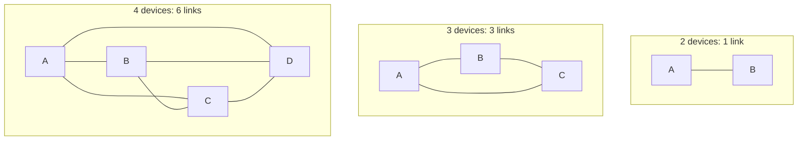
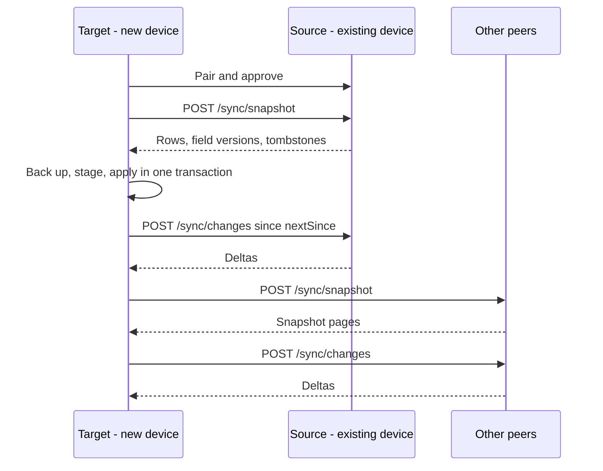

# Sync rework proposal

Status: **decided — implementation in progress**.

Shipped so far: Phase 0 (Devices empty state, manual host/port pairing, richer
snapshot card) and Phase 1 (pairing request/approval, protocol 3, `datasetId`
and `hasUserData` handshake, PIN-gated approval). The transfer is still the
read-only v13 snapshot until Phase 2 lands. The PIN remains local.

The current LAN sync is a read-only query: each device keeps its own plan and
shows a snapshot of the other. That is why jobs/homes/people and most inventory
never appear on the phone. Full sync means changing the data flow, not extending
the snapshot.

This supersedes the earlier “query, never replicate” decision. Everything else
in the project constraints still holds: offline core, optional LAN, pinned TLS,
GPL-3.0-only, Android + Linux.

## Decisions

These are settled. Do not reopen them without the user asking.

1. **Full replica** of the planner rows on every paired device. No owner/replica
   model. Context/project image blobs are device-local in v1 (see Scope).
2. **Field-level merging** using a last-writer-wins map (LWW-map) at logical
   field granularity, plus row tombstones. No text CRDT, no CRDT dependency.
3. **Only `weekStart` is synced.** Every other setting is device-local.
4. **Pairing approval** keeps the local PIN as the authorization gate.
5. **Background pairing:** in-app only for v1. A five-minute pairing window is
   an optional later extension, off by default.
6. **Initial sync:** the user chooses a **source device**, and that device's plan
   replaces the other device's plan. There is no automatic first-pairing merge.
7. **3–4 devices:** a complete pairwise mesh. Every device pairs with every
   other device and pulls from each directly. No relay in v1.
8. **Schema:** current shipped schema is v13. This work adds sync tables as
   **v14**, and backups move to v14.
9. **Transport:** pull-only. A peer serves a snapshot or its own deltas; it never
   writes into the caller's database.
10. **Log retention:** keep the local change feed append-only in v1. A full
    snapshot is always available for new devices. Compaction can add
    acknowledgements later.

## Goal

Every paired device holds a complete, editable copy of the user's planner rows.
Edits made offline on any device merge when the devices are on the same LAN.
Context/project image blobs are the one deliberate device-local exception in
v1. No cloud, no account, no telemetry, no relay.

## Scope

**Synced planner data:** spaces, contexts (jobs/homes/people), projects, habits
and habit completions, entries, time entries, completions, reminders, tags,
entry tags, shift patterns/slots/exceptions/pattern tags/checklist items/
checklist completions, home categories/locations/units/items/item-locations/
purchases, maintenance logs and shopping items.

**Synced setting:** `weekStart` only.

**Media (shipped in protocol 4):** context/project image bytes travel by
lowercase SHA-256 id. `image_media_id` is the only image field on the row and
forms one atomic merge group; the absolute `imagePath` stays device-local and is
stripped from `row_json`, snapshots, changes, media requests and media
responses. The local cache is content-addressed at
`media/cache/<sha256>.png` and served only by the signed, paired-only
`/sundial/v1/sync/media` endpoint. A normal pull retries missing images without
blocking rows; a source replacement fetches and verifies every staged image
before clearing the target, or aborts. See section 5.4 of `full-docs.md`.

**Device-local settings:** theme, locale, text size, background, navigation
side, date format, performance mode, sounds, sync/online/MCP switches, MCP
token, auto-backup settings, default reminder offsets, work hours, quiet hours,
sleep buffers, “hide Work”, timezone override and the notification queue.

**Device-local records and secrets:** identity, paired devices and shared
keys, certificate private keys, app-lock PIN/salt, MCP token, peer and snapshot
cursors, remote snapshots, context/project image files and paths, and the
device roster cache.

**Never transmit as planner rows:** pairing shared keys, certificate material,
MCP token, identity PIN/salt/hash, app-lock secrets, remote snapshots, peer or
snapshot cursors, or the roster cache. The local change feed, field versions and
tombstones are served only through the authenticated sync endpoints; they carry
no secrets.

## Multi-device topology: 3rd and 4th devices

### Supported shape

v1 supports a **complete mesh** of 2–4 devices. The protocol does not hard-cap
the count, but pairing effort is `N × (N - 1) / 2` and the UI warns above four.

| Devices | Pairwise links |
| ------: | -------------: |
|       2 |              1 |
|       3 |              3 |
|       4 |              6 |
|       5 |             10 |



Every device keeps a full replica and pulls from **every** paired peer. Each
pair has its own shared key, certificate pin and peer cursor. There is no group
key and no central hub.

### Adding a 3rd or 4th device

1. The new device `D` pairs with one existing device `A`.
2. `D` chooses `A` as the **source** and replaces its local plan with `A`'s
   snapshot. `D` adopts `A`'s `datasetId`.
3. `D` pairs with `B` and then `C`. These are same-dataset joins, so they merge
   normally; no further replacement is needed.
4. Each existing device pulls `D`'s changes, and `D` pulls each existing
   device's changes.

Joining does not require every existing device to be online at once. Pair with
any reachable member, then complete the remaining links when those devices are
available. Until a link exists, changes on that peer do not reach `D` and
`D`'s changes do not reach it. Before adding a device, the existing group should
already share one `datasetId`; if it does not, resolve the group's source choice
first.

If `D` already has an independent plan (a different `datasetId`), it is the
target, not the source, when joining an existing group. The user is warned, `D`
is backed up, and `D`'s plan is replaced. Keeping `D`'s plan instead means
replacing `A`, `B` and `C` one by one; the UI may allow it, but it is a separate
destructive action per device. If `D` already shares the group's `datasetId`
(for example after an unpair), it is a re-pair and merges normally.

### The mesh rule is real

There is **no transitive relay**. If `A` and `C` are not paired directly:

- `A`'s changes reach `B`.
- `B` applies them but does not re-emit them.
- `C` does not receive future `A` changes through `B`.

`C` only receives continuous `A` changes by pairing with `A`. A one-time
snapshot from `B` may incidentally contain fields `B` received from `A`, but
future `A` changes still require the `A`–`C` link.

The Devices page therefore shows a **group roster**: the union of peers reported
by directly paired devices, with a “not directly paired” warning and a Pair
action. The roster contains only device id, name and certificate fingerprint; it
never contains shared keys. This is a convenience check, not an authorization
mechanism.

### Removal

Unpairing is pairwise. Removing `D` from `A` does not remove `D` from `B` or `C`;
the user must unpair it everywhere. Data already synced stays on each device.
If a device is reinstalled, it gets a new device identity, so the old record
shows as offline and should be unpaired manually.

### Why not relay or a hub?

Relay needs a second log, duplicate suppression by change id, and more complex
cursor/retention rules. A hub adds a device that must be online. For 2–4
personal devices, the full mesh is simpler and keeps the server pull-only. A
future “group pairing + relay” is the upgrade path beyond four devices; it is
not v1.

## Data model: field-level LWW-map CRDT

### Logical fields, not columns

Each row is split into a small set of **merge fields**. A merge field is one or
more columns that must move together. This prevents a merge from producing an
invalid row (for example a new `startMinute` with an old `timeZone`).

| Entity | Merge fields |
| --- | --- |
| `entry` | `title`, `notes`, `classification` (space/context/project/kind), `presentation` (priority/icon), `timing` (all-day, date, end date, minutes, timezone, resolved instants), `recurrence`, `status` (status/completedAt), `maintenance` (last completed/repeat interval), `source`, `deleted` |
| `tag` | `name`, `appearance` (color/icon), `placement` (space/position), `deleted` |
| `context` | `name`, `content` (description), `appearance` (color/icon), `placement` (space/position), `deleted` |
| `project` | `name`, `content` (description), `appearance` (color/icon), `placement` (space/context/position), `deleted` |
| `habit` | `name`, `content` (description/color/icon), `schedule` (target/weekdays), `placement` (space/context/position), `archived`, `deleted` |
| `reminder` | `schedule` (offset/custom time/enabled), `deleted` |
| `shiftPattern` | `name`, `placement`, `timezone`, `cycle`, `sleep`, `enabled`, `deleted` |
| `shiftSlot` | `slot` (day index/label/start/end), `deleted` |
| `shiftException` | `exception` (date/type/start/end/note), `deleted` |
| `shiftChecklistItem` | `content` (label/day index/position), `deleted` |
| `homeCategory`, `homeLocation` | `name`, `appearance` (icon/color), `position`, `deleted` |
| `homeUnit` | `name`, `unit` (symbol/kind), `position`, `deleted` |
| `homeItem` | `identity` (name/description/icon/color/catalog/group), `classification` (category/context/location text), `stock` (quantity/min/reorder/unit/pack/expiry), `notes`, `lastPurchasedAt`, `deleted` |
| `shoppingItem` | `content` (name/quantity/unit/pack/note/links/category/icon/color/context), `checked`, `position`, `deleted` |
| `homePurchase` | `purchase` (item links/quantity/note/time), `deleted` |
| `maintenanceLog` | `service` (entry/date/next due/note/duration), `deleted` |
| `timeEntry` | `session` (entry/occurrence/start/end/note), `deleted` |
| `setting` | `value` (`weekStart` only), `deleted` |
| membership rows | `present`, `deleted` |

Membership rows are `entryTag(entryId,tagId)`,
`completion(entryId,dateKey)`, `habitCompletion(habitId,dateKey)`,
`shiftPatternTag(patternId,tagId)`,
`shiftChecklistCompletion(itemId,dateKey,slotKey)` and
`homeItemLocation(homeItemId,locationId)`.

Canonical row keys are stable strings, never local autoincrement ids:
`space(id)`, `context(id)`, `project(id)`, `habit(id)`, `timeEntry(id)`,
`entry(id)`, `reminder(id)`, `shiftPattern(id)`, `shiftSlot(syncId)`,
`shiftException(syncId)`, `shiftChecklistItem(id)`, `homeCategory(id)`,
`homeLocation(id)`, `homeUnit(id)`, `homeItem(id)`, `shoppingItem(id)`,
`homePurchase(id)`, `maintenanceLog(id)`, `setting(key)`, plus the composite
membership keys above.

`deleted` is represented by `sync_tombstone_records`, not by a normal field
version. The mapping lives in one module and is tested. Do not infer merge
fields ad hoc at call sites.

### Version: HLC

Every merge field has a version: `(physicalMillis, counter, nodeId)`. It is a
hybrid logical clock, monotonic per device even if the wall clock jumps
backward. It compares lexicographically, with `nodeId` as the final tie-break.

- Local write: `physical = max(now, last.physical)`; if `now > last.physical`,
  counter resets to 0, otherwise counter increments.
- Remote receive: advance the local HLC past the incoming version.
- Version format: fixed-width `millis:counter:nodeId`, or stored as three
  components. The wire representation must compare the same way everywhere.
- `nodeId` is a stable sync-only UUID stored in `sync_device_state`. It is not
  the pairing `deviceId`, so sync can initialize before identity exists.

Clock skew only affects conflict ordering, not convergence. A device with a
wildly future clock wins same-field conflicts until real time catches up. Test
±5 minutes; do not silently reject the change, because that would break
convergence.

### Tables (schema v14)

```
sync_device_state_records
  id                 text primary key   -- always 'local'
  node_id            text
  dataset_id         text
  epoch              text               -- local log incarnation
  hlc_millis         integer
  hlc_counter        integer
  created_at         integer
  updated_at         integer

sync_change_records
  seq                integer primary key autoincrement
  change_id          text unique        -- epoch:seq
  origin_node_id     text
  origin_epoch       text
  origin_seq         integer
  entity             text
  row_key            text
  op                 text               -- 'upsert' | 'delete'
  row_json           text               -- full row at write time
  versions_json      text               -- changed merge field -> version
  created_at         integer

sync_field_version_records
  entity             text
  row_key            text
  field              text
  version            text
  updated_at         integer
  primary key (entity, row_key, field)

sync_tombstone_records
  entity             text
  row_key            text
  version            text
  row_json           text               -- last known row, for resurrection
  updated_at         integer
  primary key (entity, row_key)

sync_peer_state_records
  peer_device_id     text primary key
  dataset_id         text
  peer_epoch         text
  last_pulled_seq    integer
  last_synced_at     integer
  last_error         text
```

`sync_change_records` is the local edit feed only. Remote applies do **not**
append to it; that is what prevents echo loops. A peer's full current state is
served by the snapshot endpoint, which includes remote-applied fields.

Indexes: `(entity, row_key)` on both version tables, `(seq)` on the change feed,
and `(entity, row_key)` on tombstones.

### Local write capture

The write hook belongs in `AppDatabase`, not only `PlannerRepository`. The
repository is the public seam, but `AppDatabase` performs multi-table writes and
side effects. A repository-only hook would miss tags, reminders, slot rows,
purchase rows, maintenance logs and derived text.

Side-effect updates (category/location/unit renames, shopping checks that
touch inventory and purchases, maintenance completion that inserts a log) are
part of the same transaction and must be recorded. The apply writer writes the
accepted row values; it does not regenerate derived text, because recomputing
on a different device could diverge.

For each mutating `AppDatabase` method:

1. Run inside the existing transaction.
2. Diff the affected rows before and after.
3. For each changed row, compute changed merge fields.
4. Append one `sync_change_records` row with the new HLC and the full row.
   Sort the transaction's change set by dependency rank: upserts parent-first,
   deletes child-first, so a peer can replay the log in sequence order with
   foreign keys enabled.
5. Upsert `sync_field_version_records` for each changed field.
6. On delete, write a tombstone and append a `delete` change.

Recording is disabled for:

- remote applies,
- migrations,
- seed defaults,
- backup import (including the reference repair it runs),
- a source replacement’s initial apply.

Reference repair after a user CSV/GymMane import records changes normally,
because those repaired ids must reach the other devices.

Add a test that every public mutating repository method produces at least one
sync change, and a coverage test that every synced table is reachable from the
mapping.

### Replace-all APIs must become per-row APIs

The current write layer replaces whole child collections:

- `saveEntry` deletes and reinserts all entry tags.
- `saveRemindersForEntry` deletes and reinserts all reminders.
- `saveShiftPattern` deletes and reinserts slots, exceptions and pattern tags.
- `saveShiftChecklistItems` diffs against the database, but can still delete a
  concurrent addition the editor never saw.

Under field-level merging, a whole-list replace can silently remove a concurrent
addition from another device. Replace these with explicit per-row operations:

- add/remove one entry tag,
- add/update/remove one reminder,
- add/update/remove one shift slot,
- set/clear one shift exception,
- add/remove one pattern tag,
- add/update/remove one checklist item.

The editors keep their local form state, but on save they emit only the changes
the user actually made. Keep the old methods only where a true replace is
semantically correct (for example a one-time import), and mark those as
non-syncing or emit calculated deletes.

`ShiftSlotRecords` and `ShiftExceptionRecords` currently use local
autoincrement ids. Add a stable `sync_id` UUID to both (domain model and
schema), generated when the slot/exception is created and preserved when it is
edited. Composite-key tables already have canonical keys.

### Apply algorithm

Apply each incoming delta page or snapshot page in one transaction. For each
row:

1. Verify `datasetId`; if it differs, stop and require source selection.
2. Verify `epoch` for this peer; if it changed, reset the cursor and request a
   snapshot.
3. Ignore the change if `change_id` was already applied.
4. For each version in `versions_json`, compare it with the local field version.
   Accept only newer versions.
5. If the incoming `__deleted` is newer than both the local tombstone and every
   local field version, write the tombstone and delete/hide the row.
6. If an incoming field version is newer than the local tombstone, clear the
   tombstone and apply the accepted fields. This is the resurrection rule.
7. Write accepted field values from `row_json`, leaving rejected groups alone.
   Keep `createdAt` as the earliest existing value; do not let a later row
   change it.
8. Set `updatedAt` to `max(existing updatedAt, max accepted physical time)`.
9. Write field versions and the peer cursor in the same transaction.

Snapshot pages are generated in dependency rank order: spaces, tags, contexts,
projects, habits and habit completions; shift patterns, then
slots/exceptions/pattern tags/checklist items/completions; entries and their
reminders/completions/entry tags/time entries; then home
categories/locations/units, home items, item-locations, shopping, purchases and
maintenance logs. Within a page, apply by the same rank. Deltas replay in
sequence order; local recording enforces parent-first upserts and child-first
deletes, so sequence order is dependency-safe. Interrupted pages are retried.
Applying a page twice is idempotent.

### Delete and resurrection

- A delete is a tombstone version.
- A newer edit on another device restores the row.
- A newer delete wins.
- Soft-deleted tables keep their row data; link tables are hard-deleted but keep
  `row_json` in the tombstone so a later edit can restore the membership.
- Completion rows are membership rows: re-completing the same occurrence is
  idempotent.

### Membership conflicts

Tag/checklist/membership rows use LWW per row: the newest add or remove wins.
There is no observed-remove set. This is deterministic and matches the earlier
“newest action wins” rule, but a concurrent add and remove do not both survive.

### Known semantic conflicts

Field-level merging prevents whole-row clobbering, but it does not make every
combination meaningful:

- `homeItem.stock` is atomic. A manual quantity edit and a shopping check that
  increments the same item resolve to the newest `stock` group; the quantities
  do not sum.
- `shiftSlot.slot` is atomic. Concurrent start-time and label edits resolve to
  the newest whole slot.
- `entry.timing` is atomic. Concurrent start-time and timezone edits resolve to
  the newest timing group.
- Same-field edits still resolve by HLC. That is expected.

Document these as accepted tradeoffs. Do not add counters or text CRDTs for v1.

### Why this still fits future peer-to-peer sharing

A field-level LWW-map is already a CRDT; character-level text is a finer
merge granularity, not a correctness prerequisite. The planned sharing layer
changes authorization, ownership and attribution, but shared planner data is
still structured rows: a household list is many small records with short
fields, not one collaboratively typed document. Per-object/per-field LWW
remains the right base for the shared namespace, and the separate shared tables
can reuse the same HLC, field-version and tombstone machinery behind scope
checks. A text CRDT would fork that path.

Character-level text CRDT only pays off when two people type into the same long
text field at the same time. Sundial's sync is periodic pull, not live
co-editing, so the main benefit is not realized. It also:

- needs an operation-based state model instead of the field snapshot/delta
  protocol;
- retains edit history that complicates deletion, revocation and privacy;
- makes per-field authorization, attribution, search and JSON backup harder;
- does not solve semantic conflicts in quantities, dates, statuses or shifts;
- adds a dependency and a large correctness surface for a personal planner.

Keep `lww` as the default for every field. For shared notes, prefer a **conflict
copy** (keep both texts with author/time) or a short field history over
character merging; that is more useful than a character-merged paragraph. If a
future feature adds real-time collaborative long-form editing, isolate a
`textCrdt` strategy to that field/surface using a vetted library. Do not replace
the sync engine or hand-roll a CRDT.

## Transport: snapshot + pull-only deltas

The LAN server stays read-only for the peer. Each device pulls the other
device's snapshot or deltas; neither writes into the other's database.

### Protocol 4 endpoints

All sync endpoints are signed with the paired shared key, timestamp, nonce and
request body. Private-network bind and certificate pinning stay unchanged. Do
not log payloads, shared keys, PINs or pairing codes; keep the existing
constant-time comparisons and nonce replay cache.

**`POST /sundial/v1/sync/snapshot`**

```
request:  { cursor?: string, limit: 500 }
response: {
  datasetId, epoch, nodeId, deviceId, generatedAt, serverHlc,
  nextSince: <seq captured when the snapshot started>,
  cursor: <opaque next page cursor>,
  done: bool,
  knownDevices: [{ deviceId, name, certificateFingerprint }],
  rows: [{
    entity, key, row, versions, deleted
  }]
}
```

- Includes live rows and tombstones, ordered by dependency rank and then
  `(entity, key)`, so a client can apply each page with foreign keys enabled.
- `versions` is the full merge-field version map for a snapshot row.
- A row is sent as a tombstone only when its tombstone is newer than every
  field version; otherwise it is live.
- `nextSince` is captured once at snapshot start. Deltas after that sequence are
  pulled after the snapshot completes, so concurrent changes are replayed.
- A crash restarts the snapshot; pages are idempotent.
- `since = 0` deltas are not used for initial sync. The snapshot is the source of
  truth because it includes remote-applied fields.

**`POST /sundial/v1/sync/changes`**

```
request:  { since: <peer seq>, limit: 200 }
response: {
  changes: [...], nextSince: <seq>, hasMore: bool,
  datasetId, epoch, nodeId, knownDevices: [...]
}
```

- Returns only this device's local changes.
- `knownDevices` is the same advisory roster as the snapshot response, so a
  newly paired device appears without waiting for a full snapshot.
- `hasMore` loops until false.
- If `epoch` or `datasetId` differs from the peer state, the client resets the
  cursor and requests a snapshot.
- A future compaction returns `resetRequired: true` when `since` is below the
  oldest retained sequence.

**`POST /sundial/v1/sync/media`**

```
request:  { ids: ["<sha256>", ...] }        // at most 32
response: {
  media: [
    { id, mime: "image/png", byteSize, data: <base64> }
  ],
  missing: ["<sha256>", ...]
}
```

- Pull-only and paired-only. The request carries hashes, never a path; the
  server validates every id as `^[0-9a-f]{64}$` and rejects malformed ids.
- Serves only files registered in the local `media_cache_records`, reading the
  content-addressed cache path and verifying the SHA-256 before answering.
  Unknown, corrupt or missing files are listed in `missing` instead of failing
  the batch.
- At most 4 MiB of raw bytes per image and 8 MiB per response. Oversized
  requests or responses are rejected with a clear error; data is never
  truncated.
- Media ids are lowercase SHA-256 of the PNG bytes. v1 only accepts `image/png`
  and validates the PNG magic bytes on receipt.

### Scheduling

Pull on app start, resume, LAN reachability, the five-minute timer and manual
refresh, for every paired peer. A device that was offline catches up per peer;
no peer blocks the others. Serialize pulls per device to avoid Drift write
contention; errors are per-peer and never block the local plan. Back off after
repeated failures.

### After applying a page

Batch the side effects:

- fetch every image id the applied rows reference but the local cache lacks,
  verify and store it, then link the affected rows to a local display path;
  a failure stays pending for the next pull and never fails the row sync;
- rebuild the notification queue if entries, reminders, shift patterns/slots/
  exceptions or completions changed;
- refresh the settings provider if `weekStart` changed;
- refresh the Android home widget;
- refresh the Devices status.

Do not play sounds or show sync notifications for ordinary remote edits.

## Initial sync: source replaces target

There is no automatic first-pairing merge. The user chooses which plan survives.



### Flow

1. Pair the devices (see pairing UX). Pause sync pulls and the local LAN
   server before the replacement starts, so peers cannot read a half-replaced
   plan.
2. Compare `datasetId` and `hasUserData`.
3. If the datasets differ, or either side has independent data, require an
   explicit source choice. There is no default when both sides have data.
   `hasUserData` ignores the seeded spaces and default tags. If both sides have
   no user data, adopt the source's empty dataset without a replacement warning.
4. The device being replaced confirms locally, with its PIN. The source device
   does not change.
5. Before clearing anything, the target creates an automatic local backup if it
   has user data. If the backup fails, abort. Keep sync paused until the
   replacement has committed and the notification/widget refresh has run.
6. The target pulls every snapshot page from the source into staging memory (or
   a temporary table), validates the dataset and every row, then applies in one
   transaction:
   - clear syncable tables and remote snapshots,
   - keep `paired_device_records`, but clear `sync_peer_state_records`,
   - apply rows, field versions and tombstones,
   - adopt the source `datasetId`,
   - generate a new local `epoch` and `nodeId`,
   - set the local HLC past the source HLC,
   - set `last_pulled_seq`,
   - adopt the source's effective `weekStart`,
   - set `defaultCategoriesSeeded` and `homeReferenceSeeded` true so an empty
     tag/category/location/unit set is not reseeded.
7. If staging or the apply fails, roll back and leave the target untouched.
8. Pull deltas from the source, then snapshot/deltas from the other peers.

The target's identity, pairing keys, certificate, MCP token and all device-local
settings survive replacement.

### What the source does not do

- It is not modified.
- It does not push.
- It only serves the snapshot when the target pulls.
- It does not replace other devices. Replacing a 3rd device is a separate action
  on that device.

### Dataset and epoch

- `datasetId` identifies the logical plan shared by the group. All devices in
  one group must share it.
- `epoch` identifies one device's local log incarnation. It changes after a
  replacement, restore or full reset.
- Peers store both. A dataset mismatch pauses sync and asks the user to resolve
  it. An epoch mismatch resets that peer's cursor and requests a snapshot.
- Two independent plans are never merged automatically on first pairing. A
  same-dataset re-pair is not a first pairing; it merges normally.

### Later recovery

The Devices page also offers “Replace this device from …” for a paired peer.
It uses the same staged, backed-up replacement. This is the recovery path after
a bad local state or a restore.

## Pairing UX

The current flow is too long: Pair → wait for discovery → open “Show a code” on
the other device → enter its PIN → read the OTP → return → type the OTP.

Proposed flow:

1. On the initiating device: Devices → Pair → pick the peer (or enter a manual
   host/port) → **Send pairing request**.
2. The other device shows an in-app card:
   `Laptop (sundial-test) wants to pair` with the certificate fingerprint,
   dataset status and **Approve / Reject**. No OTP is typed.
3. Approve asks for the local PIN. The PIN authorizes locally and is never sent.
4. Both devices derive the shared key from the existing `PairingCrypto`
   primitives using a one-time code carried in the request and bound to both
   fingerprints.
5. Both devices show the same short code/fingerprint for a final visual check.
6. If the target is being replaced, the target repeats its confirmation with the
   PIN and the backup notice.

Endpoints:

```
POST /sundial/v1/pair/request
GET  /sundial/v1/pair/request/{id}
POST /sundial/v1/pair            (existing final key exchange, request-bound)
```

The request is rate-limited, expires in five minutes, allows one active request
at a time and can be rejected without side effects. Manual host/port pairing is
restored because mDNS may be blocked.

### Background limitation

A request can only arrive while the app is running. Foregrounded: show the
dialog anywhere. Backgrounded but alive: a local notification can show it.
Killed: no listener; the initiator times out and tells the user to open
Sundial on the other device. A permanent listener needs an Android foreground
service. A five-minute “pairing mode” service is optional and off by default in
Phase 4.

### 3rd/4th device pairing

After the first pair, the new device shows the group roster and a “Pair” action
for each known-but-not-directly-paired device. The roster supplies names and
fingerprints; mDNS or the manual host/port field supplies the address. Same-
dataset pairings merge; no source prompt is shown. The roster is advisory; the
user must complete every link.

## Schema and migration (v15)

Current shipped schema: v15 (`AppDatabase.schemaVersion` and
`BackupService.currentSchemaVersion`). v14 added the five sync tables described
above. v15 adds content-addressed media on top of the same replica.

### Migration steps

1. Add the sync tables.
2. Create the local device state row with a random `nodeId`, `datasetId` and
   `epoch`.
3. Seed `sync_field_version_records` for every existing row in a synced entity
   and every merge field with one base version `(migrationMillis, 0, nodeId)`.
   Only the `weekStart` setting row is seeded; other settings are device-local.
4. Seed tombstones for synced rows where `deletedAt` is already set, using
   counter 1 so the tombstone is strictly newer than the seeded fields.
5. Add stable `sync_id` UUIDs to shift slots and shift exceptions; backfill
   existing rows.
6. Stop writing `remote_snapshot_records`. Drop it after the Devices page no
   longer reads it, in the same release if the UI is replaced, otherwise in a
   follow-up migration.
7. Do not seed change records for existing rows. Initial sync reads the
   snapshot, not the historical log.

### v15 media migration

1. Add nullable `image_media_id` to `context_records` and `project_records`.
2. Create `media_cache_records` (`media_id` primary key, `path`, `mime`,
   `byte_size`, `created_at`). It is device-local and never synced.
3. For every context/project with a non-empty `image_path`, read the display
   file, validate the PNG signature, hash it, ensure
   `media/cache/<sha256>.png` and insert the index row, then set
   `image_media_id`. A missing, corrupt or oversized file leaves that id null;
   one bad file never fails the upgrade.
4. Seed field versions again after the columns exist, because the v14 step
   skips entities whose payload is incomplete.
5. `image_path` stays a display path and remains stripped from sync payloads.
   Only `image_media_id` travels, as one atomic merge group.

### Backups

- Backup schema moves to v15.
- Exclude all sync tables, remote snapshots and `media_cache_records`.
- Keep identity/pairing/MCP/app-lock exclusions.
- Import accepts v3–v15.
- Context/project JSON carries `imageMediaId`. The existing `media` map carries
  display bytes, or the cache bytes when the display copy is gone. Import
  verifies or computes hashes, restores `imageMediaId`, writes the display
  files, writes the cache copies and rebuilds `media_cache_records`; a v14
  backup without ids computes them from the restored bytes.
- Stop sync before import. After import: clear sync tables and remote
  snapshots, generate a new `datasetId`, `nodeId` and `epoch`, clear peer
  cursors and require a full snapshot/source selection. A stale cursor must
  never skip restored data. Restart sync only after the import and notification
  rebuild complete.
- The backup still carries all user data and all settings, including
  `weekStart`.

### `clearAllData`

Stop sync first, then add sync tables, remote snapshots and `media_cache_records`
to the delete list. The managed media folder (including `media/cache`) is
removed by the caller after the database transaction. Identity is already
deleted, which stops sync; a new device state is created on next start.

### Source replacement clear

This is not `clearAllData`. It keeps identity, pairing, certificate, MCP token
and device-local settings. It clears only syncable data and sync bookkeeping,
then applies the source snapshot. It does **not** clear `media_cache_records` or
the cache files: the new rows resolve their ids from that cache, and delayed
peers may still need old hashes. Before clearing, every image id in the staged
snapshot is fetched and verified; a failure aborts the replacement.

## What happens to the current snapshot UI

- The read-only remote-snapshot card and `RemoteSnapshot` model are replaced by
  real synced data.
- The Devices page becomes sync status: last successful pull, peer reachability,
  dataset/epoch state, errors, roster, replace-from and unpair.
- `remote_payload.dart` is still used by the MCP adapter. Move the MCP JSON
  helpers to `lib/features/mcp/mcp_payloads.dart` before removing the LAN
  snapshot code, so MCP does not break.
- Remove the old `/sundial/v1/query` snapshot endpoint from the LAN server and
  bump `protocolVersion` to 3. The MCP server does not use the LAN endpoint.
- `remote_snapshot_records` is no longer written; drop it when the UI is gone.

## Implementation map

| Area | Files |
| --- | --- |
| Schema v14, migration, write recording, snapshot queries, apply writer | `lib/services/app_database.dart` |
| Per-row write API and sync operations | `lib/services/planner_repository.dart` |
| Sync snapshot/change/apply store; LAN server never touches Drift directly | new `lib/features/sync/sync_store.dart` |
| Merge-field mapping | new `lib/features/sync/sync_field_groups.dart` |
| HLC and version comparison | new `lib/features/sync/sync_clock.dart` |
| Change/snapshot DTOs | new `lib/features/sync/sync_models.dart` |
| Pull/apply/snapshot/replace orchestration | new `lib/features/sync/sync_engine.dart` |
| Signed sync endpoints, protocol 4 | `lib/features/sync/lan_server.dart` |
| Signed client calls | `lib/features/sync/lan_client.dart` |
| Scheduling, peer state, errors | `lib/features/sync/sync_service.dart` |
| Pairing request/approval | `lib/features/sync/`, `pairing_crypto.dart` |
| Status, roster, source selection, manual host/port | `lib/features/sync/pages/devices_page.dart` |
| v14/v15 backup, exclusions, reset | `lib/features/backup/backup_service.dart` |
| Content-addressed media store | `lib/features/media/media_store.dart` |
| Media columns, index, migration, local linking | `lib/services/app_database.dart` |
| Media fetch/verify/retry and strict staging | `lib/features/sync/sync_engine.dart` |
| MCP payload move | new `lib/features/mcp/mcp_payloads.dart`, `lib/features/mcp/mcp_server.dart` |
| Notifications/widget refresh after apply | notification service, home widget provider |
| MCP writes | already use `PlannerRepository` -> `AppDatabase`, so they record changes like UI writes |
| Tests | `test/sync_*`, `test/migration_test.dart`, `test/backup_test.dart` |

## Phases

**Phase 0 — quick wins (small)**

- Fix the misleading Devices empty state.
- Restore manual host/port pairing.
- Show synced inventory/contexts in the current snapshot card as an interim.

**Phase 1 — pairing request (medium)**

- `POST /sundial/v1/pair/request` + status/approval flow; in-app approve/reject
  with PIN.
- Dataset/`hasUserData` handshake.
- Source-selection UI, including the “target confirms replacement” step.
- Tests for approve, reject, expiry, rate limit, manual address and dataset
  mismatch.

**Phase 2 — sync foundation (largest) — SHIPPED 2026-11-21**

- [x] v14 schema, field-version/tombstone tables, HLC and migration fixtures.
- [x] Merge-field mapping and change recording in `AppDatabase`.
- [x] Replace-all child writes with per-row operations.
- [x] `sync/snapshot` pagination, `sync/changes`, transactional apply, peer cursors.
- [x] Two-device integration test with a fake transport.
- [x] Tests for field merge, same-field LWW, delete/edit, clock skew, idempotency,
  rollback and interrupted pages.

Shipped files: `lib/services/app_database_sync.dart`,
`lib/features/sync/sync_clock.dart`, `sync_field_groups.dart`, `sync_models.dart`,
`sync_store.dart`, `sync_engine.dart`, the two signed endpoints in `lan_server.dart`,
and `LanClient` as the transport. The running app does not pull yet; scheduling
and source replacement are Phase 3.

**Phase 3 — full coverage, multi-device and UI — SHIPPED 2026-11-21**

- [x] Wire every table and the `weekStart` whitelist.
- [x] Source replacement with staging, backup and rollback.
- [x] 3-device and 4-device mesh integration tests; missing-link test.
- [x] Roster and “not directly paired” warnings.
- [x] Replace snapshot UI with sync status; remove remote snapshots from the UI
  path (the endpoint and table are kept one release for the MCP payload
  dependency).
- [x] Backup v14, v13 fixture upgrade, docs.
- [x] Notifications/widget refresh after sync.
- [ ] Real-device test on Android + Linux, with a third device or emulator if
  available. Automated mesh and replacement coverage is green; the physical
  two-device pass is the user's remaining step.

**Phase 4 — optional background**

- Pairing/sync foreground service or five-minute pairing window, with a clear
  setting, off by default.

**Phase 5 — content-addressed media (Design B) — SHIPPED 2026-11-21**

- [x] Schema v15: `image_media_id` on contexts/projects and the device-local
  `media_cache_records` index; v14 backfill with real and missing files.
- [x] `MediaStore` at `.../media/cache/<sha256>.png`, immutable and shared;
  editor deletion refuses cache paths.
- [x] `image` merge group on contexts/projects; `image_path` stays stripped.
- [x] Protocol 4 signed, paired-only `POST /sundial/v1/sync/media` with id,
  hash, size and response-budget validation.
- [x] Normal pulls fetch missing images without blocking rows and retry later;
  source replacement verifies all staged media before clearing the target.
- [x] Backup v15 carries `imageMediaId` and cache bytes and rebuilds the local
  index; v14 imports compute ids.
- [ ] Real-device image pass (desktop → phone, replacement with images, offline
  change/remove, peer-offline retry).

## Acceptance criteria

- A job/home/entry/inventory item created on any device appears on every other
  paired device after a sync, in the normal screens.
- Offline edits on two devices that touch different fields both survive.
- Same-field edits converge deterministically by HLC.
- A delete on A removes the row on B; a newer edit on B restores it.
- Tag/checklist/shopping membership add/remove resolves deterministically.
- Completing the same occurrence on two devices produces one completion row.
- Interrupted sync leaves no partial rows and retries safely.
- A 3rd device joins from a chosen source, then receives rows from the other
  existing devices.
- A 4-device mesh converges; removing one direct link stops transitive updates
  and re-pairing restores them.
- Replacing a target from a source is staged: a failure leaves the target
  intact, and a success preserves identity, pairing, MCP token and device-local
  settings.
- `weekStart` follows the source on replacement and syncs thereafter; every
  other setting stays local.
- Context/project icon and color sync. Only `image_media_id` syncs; `image_path`
  and the image files remain device-local and are absent from every non-media
  sync payload. The media endpoint carries bytes only by content hash.
- No identity PIN/salt/hash, pairing shared key, certificate private key, MCP
  token, app-lock secret, peer cursor, snapshot cursor or remote snapshot is
  ever in a sync payload. Field versions and tombstones for synced rows are
  expected sync metadata and carry no secrets. Public device id, name and
  certificate fingerprint may appear in the advisory roster; certificate
  material and keys may not.
- v13 data upgrades with real rows, v13 backups restore, and both builds pass.
- Context/project images replicate between paired devices, a replaced image is
  not shown stale while pending, and a missing image never blocks row sync or a
  source replacement of rows. Source replacement carries images or aborts before
  clearing the target.

## Test matrix

- HLC monotonicity, wall-clock rollback, tie-break and ±5-minute skew.
- Merge-field groups for every entity, including timing/stock/slot atomicity.
- Two-device, three-device and four-device fake-transport convergence.
- Missing mesh link: A–B and B–C paired, A–C not paired; A changes do not reach
  C until A–C is paired.
- Source replacement: staging failure rollback, backup failure abort, successful
  adoption, identity/pairing preservation, dataset/epoch changes and no partial
  plan served while sync is paused.
- Dataset mismatch and epoch-change reset.
- Delete/edit resurrection; membership add/remove; duplicate completion.
- Concurrent tag/reminder/slot add plus a whole-form save does not delete the
  concurrent addition.
- Interrupted snapshot page, interrupted delta page, idempotent replay.
- v13 → v14 migration with real rows, soft deletes and shift slots/exceptions.
- v14 → v15 migration with real image files plus missing/corrupt files.
- Backup v13 → v15 and post-restore sync reset; v14 import computes media ids;
  `media_cache_records` absent from export and rebuilt on import.
- Media store hashing, duplicate content, immutable cache and PNG/oversize
  validation.
- Two-device image add/replace/remove/offline catch-up and media-fetch retry.
- Media endpoint: paired success, unpaired/tampered/replay rejection, unknown,
  malformed, path-like and oversized id lists, oversized image/response.
- Mesh image convergence and the no-relay rule for media.
- Sync payload secrecy: no identity PIN/salt/hash, pairing shared key,
  certificate private key, MCP token, app-lock data, peer/snapshot cursor,
  remote snapshot or local image path. Field versions/tombstones are expected;
  only public device id/name/fingerprint may appear in the roster.
- Pairing request approve/reject/expiry/rate-limit/manual address.
- Devices status, roster, source selection and destructive confirmation widgets.
- Notification queue and home widget refresh after a remote apply.

## Alternatives considered

- **Owner/replica:** one device is the source of truth; the other asks it for
  data and queues edits. Simpler merge, but the owner must be online to sync and
  the replica cannot work fully offline. It still needs a change queue and a
  conflict rule. Rejected.
- **File-level sync (Syncthing/Dropbox on the SQLite file):** SQLite writes a
  WAL and both devices would overwrite the whole file. Concurrent edits can
  corrupt the database and there is no record-level merge. Rejected.
- **Cloud sync (Firebase/Supabase/PowerSync):** requires accounts, a server and
  network; violates the offline/no-cloud constraints. Rejected.
- **A LAN hub (Raspberry Pi):** a central source of truth solves ordering but
  adds a device that must be online; the devices should not depend on it.
  Rejected for v1.
- **Character-level text CRDT:** excellent for live collaborative text, but it
  adds a dependency and a large correctness surface for a personal planner and
  does not solve structured-field conflicts. The field-level LWW-map is the
  chosen middle ground. Keep the door open for a future real-time co-editing
  surface, scoped to a notes field and backed by a vetted library.
- **Relay/group key for 3+ devices:** removes the `N²` pairing effort, but adds
  a relay log, change-id dedupe and more cursor rules. Rejected for v1; the
  full mesh is simpler at 2–4 devices.
- **Manual conflict prompts:** safest for data, worst for daily use; the user
  would get dialogs for ordinary edits. Use field-level LWW and document it.
- **Automatic first-pairing merge:** ambiguous when both devices have real
  plans; the user explicitly chose source replacement. Rejected.

## Remaining implementation choices

These are not blocking. Decide during the phase and record the result in
`docs/full-docs.md`:

- Snapshot page size and response byte cap (start with 500 rows / 1 MB).
- Whether the group roster is part of Phase 3 or a later polish pass.
- Exact retry/backoff intervals per peer.
- Whether `remote_snapshot_records` is dropped in v14 or kept read-only for one
  release for upgrade safety.
- Exact UI copy for the destructive source-replacement confirmation.
- Whether `sync_field_groups.dart` exposes a per-field strategy enum now or only
  when the first non-LWW field appears. v1 stays LWW-only.
- Conflict-copy versus short field-history UX for shared notes once the sharing
  layer lands.
